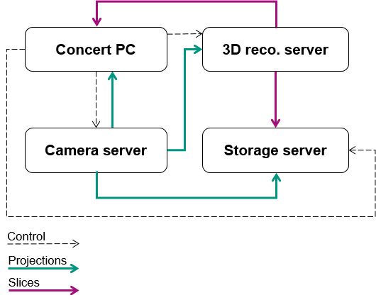

===========
Experiments
===========

Experiments perform the data acquisition and send the data to consumers.  They
consist of :class:`.Acquisition` objects which connect data producers with
consumers for a particular experiment part (dark fields, projections, ...). This
way the experiments can be divided into smaller logical pieces. Data consumers
are implemented by various :class:`.Addon` classes (e.g.  image writing, live
view, ...), which can be attached to or detached from experiments dynamically.

Data handling can be realized `locally` or `remotely`. Local data handling keeps
all data in your concert session, which may lead to performance decrease. Remote
data handling means that the producer lives on a separate computer and all
addons as well and concert merely organizes the data links by `ZMQ
<https://pyzmq.readthedocs.io/en/latest/>`_ and the synchronization of the data
acquisition.  This is the preferred way because it lifts the burden of data
processing from your concert session. Below you can find examples for
:ref:`local <local-exp>` and :ref:`remote <remote-exp>` experiments.
Schematically, the data and control links of the latter are:

Running an experiment
---------------------

:class:`~.base.Experiment` makes sure all acquisitions are executed and all
producers are connected to all consumers. To demonstrate how a typical
experiment can be run in an empty session with dummy devices::

    from concert.storage import DirectoryWalker
    from concert.ext.viewers import PyplotImageViewer
    from concert.experiments.addons import local as local_addons
    from concert.devices.motors.dummy import LinearMotor, ContinuousRotationMotor
    from concert.devices.cameras.dummy import Camera
    from concert.devices.shutters.dummy import Shutter

    # Import experiment
    from concert.experiments.synchrotron import LocalContinuousTomography

    # Devices
    camera = await Camera()
    shutter = await Shutter()
    flat_motor = await LinearMotor()
    tomo_motor = await ContinuousRotationMotor()

    viewer = await PyplotImageViewer()
    walker = await DirectoryWalker()
    exp = await LocalContinuousTomography(
        walker=walker,
        flat_motor=flat_motor,
        tomography_motor=tomo_motor,
        radio_position=0*q.mm,
        flat_position=10*q.mm,
        camera=camera,
        shutter=shutter
    )

    # Attach live_view to the experiment
    live = await local_addons.LiveView(viewer=viewer, experiment=exp)

    # Attach image writer to experiment
    writer = await local_addons.ImageWriter(experiment=exp)

    # Run the experiment
    f = exp.run()

    # Wait until the experiment is done
    await f

Experiments also have a :py:attr:`.base.Experiment.log` attribute, which gets a
new handler on every experiment run and this handler stores the output in the
current experiment working directory defined by it's
:class:`concert.storage.DirectoryWalker`.

Scanning parameters with images
-------------------------------

For a complete guide covering local and remote scans, arbitrary lists, ranges,
traversal orders, dynamic parameters and image metadata, see
:ref:`parameter-scanning`.

:class:`concert.experiments.scan.LocalScan` acquires one software-triggered image
for each combination of device parameter values. The last axis changes fastest,
just as in :func:`concert.processes.common.scan`::

    from concert.experiments.scan import LocalScan, RemoteScan
    from concert.experiments.addons import local as local_addons
    from concert.quantities import q

    exp = await LocalScan(
        axes={
            'x': (motor['position'], [0, 1, 2] * q.mm),
            'exposure': (camera['exposure_time'], [1, 5] * q.ms),
        },
        camera=camera,
        go_back=True,
        walker=walker,
    )

    # Inspect all axes, their positions and the total image count.
    print(await exp.get_scan_plan())
    print(await exp.get_num_positions())  # 6

    # Adjust a regular range, including the endpoint by default.
    await exp.axes['x'].set_range(0 * q.mm, 10 * q.mm, 2 * q.mm)

    # Or supply arbitrary positions.
    await exp.axes['exposure'].set_values([1, 2, 10] * q.ms)

    writer = await local_addons.ImageWriter(experiment=exp)
    await exp.run()

For a one-dimensional scan, pass a single device parameter and its position
sequence. Without explicit names, axes are named ``axis_0``, ``axis_1``, etc.
Each axis also has the usual Concert ``info_table``. Positions can only be
changed between runs; invalid empty ranges or steps pointing away from the
endpoint are rejected without replacing the previous positions.

``LocalScan`` has one local acquisition, ``exp.scan``, which yields images to
the usual local addons. ``Scan`` remains a compatibility name for ``LocalScan``.
For remote acquisition, use ``RemoteScan`` with the same parameters::

    exp = await RemoteScan(
        axes={'x': (motor['position'], [0, 1, 2] * q.mm)},
        camera=remote_camera, go_back=True, walker=walker,
    )
    print(await exp.get_scan_plan())
    await exp.axes['x'].set_range(0 * q.mm, 10 * q.mm, 2 * q.mm)

    # Attach remote addons (e.g. concert.experiments.addons.tango.ImageWriter)
    # configured for the camera's remote endpoints, then run the experiment.
    await exp.run()

``RemoteScan`` triggers and calls ``camera.grab_send(1, end=...)`` at every
position. Only the last image ends the stream; images are sent directly to remote
addons rather than returned to the session. Its camera must support the normal
remote acquisition endpoint registration. Local and remote addons cannot be
mixed within an acquisition.

Both modes share the same editable axes and include the scan plan in parameter logging.

Local scan image metadata
~~~~~~~~~~~~~~~~~~~~~~~~~

Each ``LocalScan`` image carries a ``scan`` entry in its metadata, preserving
the camera's existing metadata. For example::

    image.metadata['scan']
    # {
    #     'iteration': 3,
    #     'indices': [1, 0],
    #     'order': 'snake',
    #     'axes': {
    #         'x': {'parameter': 'position', 'value': '5 millimeter'},
    #         'exposure': {'parameter': 'exposure_time', 'value': '0.001 second'},
    #     },
    # }

Values are actual parameter read-backs sampled immediately before triggering,
not just the requested positions. Axis names distinguish multiple parameters
with the same name, such as two motors' ``position`` parameters. Iteration and
grid indices are zero-based. Values are strings including units so standard
image writers can serialize the metadata as JSON. Each image has an independent
metadata snapshot which remains unchanged as the scan continues or restores
the original positions. Remote scan image metadata is not modified by the
local session.

Dynamic axis parameters
~~~~~~~~~~~~~~~~~~~~~~~

Scan experiments automatically install Concert parameters for each named axis.
For ``names=['x', 'y']``, these include:

* ``scan_x``: a read-only live summary, for example
  ``position: values=[5 millimeter, 0 millimeter, 2 millimeter]; 3 points; order=snake``.
* ``scan_x_values``: the actual positions, editable between runs.
* ``scan_x_start``, ``scan_x_stop``, ``scan_x_step``: read-only range settings,
  or ``None`` when explicit positions are configured.
* ``scan_x_num_points``: read-only number of positions.

The same parameters are installed for ``y``. They appear automatically in the
normal Concert parameter table and experiment metadata::

    print(await exp.info_table)
    print(await exp.get_scan_x())
    await exp.set_scan_x_values([8, 1, 4] * q.mm)
    # Equivalent parameter access:
    await exp['scan_x_values'].set([8, 1, 4] * q.mm)
    # Regular ranges continue to be configured atomically on the axis:
    await exp.axes['x'].set_range(0 * q.mm, 10 * q.mm, 2 * q.mm)

These are live views: changes through ``axes`` are immediately reflected in the
generated parameters and vice versa. Axis names with punctuation or spaces are
converted to valid parameter names (``sample x`` becomes ``scan_sample_x``).
``exp.axis_parameter_names`` maps each axis name and field to its generated name.
Conflicting generated names are rejected. Parameters are instance-specific and
do not appear on other scans with different axes.

Arbitrary values and traversal order
~~~~~~~~~~~~~~~~~~~~~~~~~~~~~~~~~~~

Each axis accepts an arbitrary non-empty list, including irregular spacing,
unsorted values, repeated values, or individual quantities with compatible
units. Lists are never sorted. For example::

    exp = await LocalScan(
        [x_motor['position'], y_motor['position']],
        [[5 * q.mm, 0 * q.mm, 2 * q.mm], [1 * q.mm, 7 * q.mm, 3 * q.mm]],
        camera=camera, names=['x', 'y'], order='snake',
    )
    await exp.axes['x'].set_values([8 * q.mm, 1 * q.mm, 4 * q.mm])
    await exp.set_order('spiral')
    print(await exp.get_position_indices(3))
    print(await exp.get_scan_plan())

The ``order`` keyword and ``set_order`` support:

* ``raster`` (default): Cartesian order, last axis fastest.
* ``snake``: reflected traversal, reversing alternate rows. Works for any
  number of axes and visits adjacent grid indices without row-reset jumps.
* ``spiral``: clockwise, outside-in traversal of exactly two axes. Starts at
  index ``(0, 0)`` and moves along the second axis first. Rectangular grids and
  single-row/column grids are supported.

For a 3-by-3 grid, the visitation indices are::

    snake:  (0,0) (0,1) (0,2) (1,2) (1,1) (1,0) (2,0) (2,1) (2,2)
    spiral: (0,0) (0,1) (0,2) (1,2) (2,2) (2,1) (2,0) (1,0) (1,1)

Orders operate on list indices, not physical distances. An unsorted list can
therefore still cause large physical moves. Change order only between runs.
The same options apply to ``RemoteScan`` and scan directors.

The original trigger source is restored after acquisition. With ``go_back=True``,
scanned parameters are restored as well, including on failure or cancellation.
This experiment does not control a shutter or acquire dark/flat fields.

.. _local-exp:

Local dummy file experiment
---------------------------

The following session illustrates how to use an
:class:`~concert.experiments.dummy.ImagingFileExperiment` together with
:class:`~concert.experiments.addons.local.LiveView`,
:class:`~concert.experiments.addons.local.ImageWriter` and
:class:`~concert.experiments.addons.local.OnlineReconstruction` addons::

    import numpy as np
    import logging
    import concert
    concert.require("0.33.0")

    from concert.devices.cameras.dummy import FileCamera
    from concert.devices.shutters.dummy import Shutter
    from concert.devices.motors.dummy import ContinuousRotationMotor, ContinuousLinearMotor
    from concert.quantities import q
    from concert.experiments.addons import local as local_addons
    from concert.experiments.dummy import ImagingFileExperiment
    from concert.storage import DirectoryWalker
    from concert.ext.viewers import PyQtGraphViewer, PyplotImageViewer
    from concert.ext.ufo import GeneralBackprojectArgs, GeneralBackprojectManager

    concert.config.PROGRESS_BAR = False
    LOG = logging.getLogger(__name__)

    viewer = await PyQtGraphViewer(show_refresh_rate=True)
    slice_viewer = await PyQtGraphViewer(show_refresh_rate=True, title="Slices")

    num_radios = 3000

    walker = await DirectoryWalker(
        root='/mnt/fast/tests',
        bytes_per_file=2 ** 40,
    )
    flat_motor = await ContinuousLinearMotor()
    rot_motor = await ContinuousRotationMotor()
    shutter = await Shutter()
    vert_motor = await ContinuousLinearMotor()

    camera = await FileCamera(pattern="/mnt/fast/CT42/radios/*.tif")
    await camera.set_roi_y0(800 * q.px)
    await camera.set_roi_height(200 * q.px)
    # Imaging file dummy experiment
    ex = await ImagingFileExperiment(
        camera=camera,
        num_darks=100,
        num_flats=100,
        num_radios=num_radios,
        darks_pattern='/mnt/fast/CT42/darks',
        flats_pattern='/mnt/fast/CT42/flats',
        radios_pattern='/mnt/fast/CT42/radios',
        walker=walker,
    )

    # Live view
    live = await local_addons.LiveView(viewer=viewer, experiment=ex)

    # Writer
    writer = await local_addons.ImageWriter(experiment=ex)

    # Online Reco
    reco = await local_addons.OnlineReconstruction(
        experiment=ex,
        do_normalization=True,
        average_normalization=True,
        slice_directory="online-slices",
        viewer=slice_viewer
    )
    await reco.set_region([0., 1., 1.])
    await reco.set_center_position_x([1009.0] * q.px)
    await reco.set_fix_nan_and_inf(True)
    await reco.set_absorptivity(True)
    await reco.set_center_position_z([0.5] * q.px)
    await reco.set_number(num_radios)
    await reco.set_overall_angle(np.pi * q.rad)

.. _remote-exp:

Remote dummy file experiment
----------------------------

The following session illustrates the remote version of the experiment above.
Cameras in concert can send images over network, so we can just use the file
camera here as well. The following session uses a
:class:`~concert.experiments.dummy.RemoteFileImagingExperiment` together with
:class:`~concert.experiments.addons.tango.LiveView`,
:class:`~concert.experiments.addons.tango.ImageWriter` and
:class:`~concert.experiments.addons.tango.OnlineReconstruction` addons::

    import logging
    import numpy as np
    import os
    import zmq
    import concert
    import time
    concert.require("0.33.0")

    from concert.devices.cameras.dummy import FileCamera
    from concert.helpers import CommData
    from concert.quantities import q
    from concert.networking.base import get_tango_device
    from concert.experiments.addons import tango as tango_addons
    from concert.experiments.dummy import RemoteFileImagingExperiment
    from concert.storage import RemoteDirectoryWalker
    from concert.ext.viewers import PyQtGraphViewer
    from concert.experiments.addons.tango import (
        ImageWriter as TangoRemoteWriter,
        OnlineReconstruction as TangoOnlineReconstruction,
        LiveView as TangoLiveView
    )

    concert.config.PROGRESS_BAR = False
    LOG = logging.getLogger(__name__)
    viewer = await PyQtGraphViewer(show_refresh_rate=True)
    slice_viewer = await PyQtGraphViewer(show_refresh_rate=True, title="Slices")
    num_radios = 3000

    SERVERS = {
            "writer": CommData("localhost", port=8992, socket_type=zmq.PUSH),
            "reco": CommData("localhost", port=8993, socket_type=zmq.PUSH),
            "live": CommData("localhost", port=8995, socket_type=zmq.PUB, sndhwm=1),
    }

    walker_device = get_tango_device(
        f'{os.uname()[1]}:1238/concert/tango/walker#dbase=no', timeout=1000 * q.s
    )
    walker = await RemoteDirectoryWalker(
        device=walker_device,
        root='/mnt/fast/tests',
        bytes_per_file=2 ** 40,
    )

    camera = await FileCamera(pattern="/mnt/fast/CT42/radios/*.tif")
    await camera.set_roi_y0(800 * q.px)
    await camera.set_roi_height(200 * q.px)
    ex = await RemoteFileImagingExperiment(
        camera=camera,
        num_darks=100,
        num_flats=100,
        num_radios=num_radios,
        darks_pattern='/mnt/fast/CT42/darks',
        flats_pattern='/mnt/fast/CT42/flats',
        radios_pattern='/mnt/fast/CT42/radios',
        walker=walker,
    )

    # Live View
    if "live" in SERVERS:
        live = await TangoLiveView(viewer=viewer, endpoint=SERVERS["live"], experiment=ex)

    # Writer
    writer = await tango_addons.ImageWriter(experiment=ex, endpoint=SERVERS["writer"])

    # Online Reco
    if "reco" in SERVERS:
        reco_device = get_tango_device(f'{os.uname()[1]}:1237/concert/tango/reco#dbase=no', timeout=1000 * q.s)
        # await reco_device.write_attribute('endpoint', SERVERS["reco"].client_endpoint)
        reco = await tango_addons.OnlineReconstruction(
            device=reco_device,
            experiment=ex,
            endpoint=SERVERS["reco"],
            do_normalization=True,
            average_normalization=True,
            slice_directory="online-slices",
            viewer=slice_viewer
        )
        await reco.set_region([0., 1., 1.])
        await reco.set_center_position_x([1009.0] * q.px)
        await reco.set_fix_nan_and_inf(True)
        await reco.set_absorptivity(True)
        await reco.set_center_position_z([0.5] * q.px)
        await reco.set_number(num_radios)
        await reco.set_overall_angle(np.pi * q.rad)
        # Online reco uses its own separate walker for writing
        await reco_device.setup_walker(
            [
                f'{os.uname()[1]}:2238/concert/tango/walker#dbase=no',
                '/mnt/fast/tests',
                "tcp", "localhost", "8996"
            ]
        )

The experiment above needs tango servers for the respective addons to be
started, which can be done by::

    concert tango reco --port 1237
    concert tango walker --port 1238
    concert tango walker --port 2238

Addons
------

Addons typically provide consumers for different kinds of acquisitions in an
experiment. E.g., online 3D reconstruction will average the dark fields and flat
fields and trigger the reconstruction in the acquisition taking the projections.
Addons attach themselves to experiment acquisitions upon creation and can be
later detached from them. They can be `local` or `remote`, depending on where
the data comes from. For example, to save images on disk locally::

    from concert.experiments.addons.local import ImageWriter

    # Let's assume an experiment is already defined
    writer = ImageWriter(experiment=experiment)
    # Now images are written on disk
    await experiment.run()
    # Do not write images anymore
    await writer.detach()

Experiment base module
----------------------

.. automodule:: concert.experiments.base
    :members:

Dummy experiments
-----------------

.. automodule:: concert.experiments.dummy
    :members:

Addon classes
-------------

.. automodule:: concert.experiments.addons.base
    :members:
   
.. automodule:: concert.experiments.addons.local
    :members:

.. automodule:: concert.experiments.addons.tango
    :members:

Advanced
--------

Sometimes we need finer control over when exactly is the data acquired and worry
about the download later. We can use the *acquire* argument to acquisition
class. This means that the data acquisition can be invoked before data download.
Acquisition runs its *acquire* hook first and only when it is finished connects
the producer with consumers.

The Experiment class has the attribute
:py:attr:`.base.Experiment.ready_to_prepare_next_sample` which is an instance of
an :class:`asyncio.Event`. This can be used to tell that most of the experiment
is finished and a new iteration of this experiment can be prepared (e.g. by the
:class:`concert.directors.base.Director`.  In the :meth:`.base.Experiment.run`
the :py:attr:`.base.Experiment.ready_to_prepare_next_sample` will be set that at
the end of an experiment is is always set. In the beginning of the
:meth:`.base.Experiment.run` it will be cleared.  This is an example
implementation making use of this::

	from concert.experiments.base import Experiment, Acquisition
	class MyExperiment(Experiment):
		async def __ainit__(self, *, walker, camera, **kwargs):
			acq = Acquisition(name="acquisition", producer_corofunc=self._produce_frames)
			self._camera = camera
			await super().__ainit__(acquisitions=[acq], walker=walker, **kwargs)

		async def _produce_frame(self):
			num_frames = 100
			async with self._camera.recording():
				# Do the acquisition of the frames in camera memory

			# Only the readout and nothing else will happen after this point.
			self.ready_to_prepare_next_sample.set()

			async with self._camera.readout():
				for i in range(num_frames):
					yield await self._camera.grab()

Imaging experiments
-------------------

A basic frame acquisition generator which triggers the camera itself is provided by
:func:`.frames`

.. autofunction:: concert.experiments.imaging.frames

There are tomography helper functions which make it easier to define the proper
settings for conducting a tomographic experiment.

.. autofunction:: concert.experiments.imaging.tomo_angular_step

.. autofunction:: concert.experiments.imaging.tomo_projections_number

.. autofunction:: concert.experiments.imaging.tomo_max_speed

Synchrotron and X-Ray tube experiments
--------------------------------------

In :py:mod:`concert.experiments.synchrotron` and :py:mod:`concert.experiments.xraytube` experiment classes for
Radiography, SteppedTomography, ContinuousTomography and SteppedSpiralTomography,
ContinuousSpiralTomography and GratingInterferometryStepping are implemented for
the two different source types as local and remote experiments.

For detailed information how they are implemented, you can have a look at the
base classes :class:`~concert.experiments.imaging.Radiography`,
:class:`~concert.experiments.imaging.Tomography`,
:class:`~concert.experiments.imaging.SteppedTomography`,
:class:`~concert.experiments.imaging.ContinuousTomography`,
:class:`~concert.experiments.imaging.SteppedSpiralTomography`,
:class:`~concert.experiments.imaging.ContinuousSpiralTomography` and
:class:`~concert.experiments.imaging.GratingInterferometryStepping`.

In the standard configuration, all tomography and radiography experiments first
acquire the dark images, then the flat images and the projection images of the
sample at the end. This order can be adjusted by the
:func:`~concert.experiments.base.Experiment.swap` command.

You can find more details on the different experiments in :ref:`Experiment implementations <exp-implementations>`.

Control
-------

.. automodule:: concert.experiments.control
    :members:
